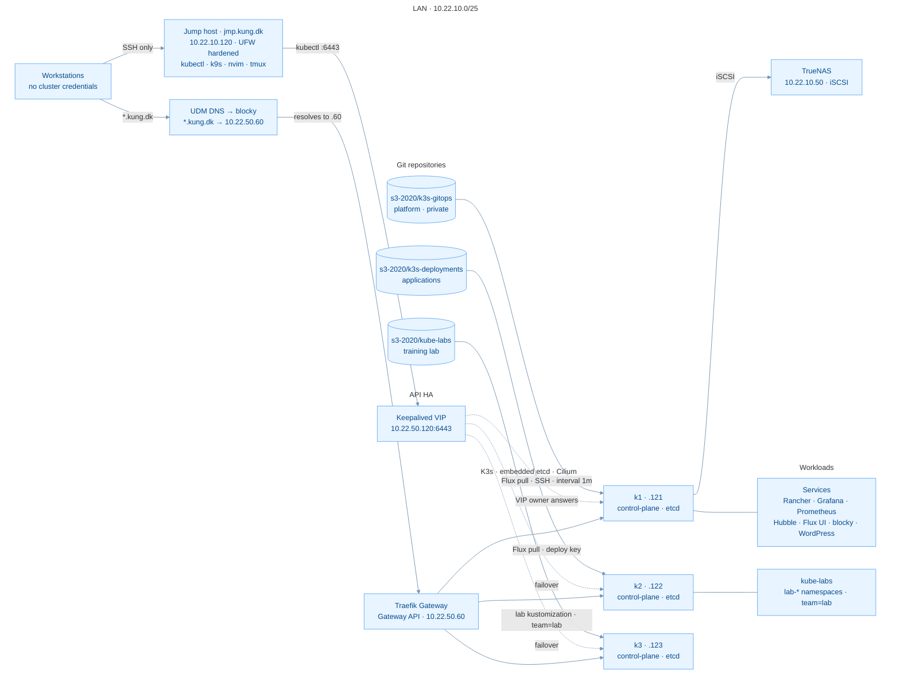

# Homelab — a production-minded K3s platform at home

Data technician (IT infrastructure) student at team.blue, finishing January
2027. Cisco CCNA certified, currently studying for CCNP.

This is my home platform: three bare-metal nodes running K3s with an HA
control-plane, Cilium networking and full GitOps. It hosts my self-hosted
services *and* a structured training lab (`kube-labs`) that runs safely
alongside production in labelled namespaces.

It is intentionally small — but it follows the same principles as
professional operations: declared state, tested recovery, observability and
reproducibility.

## Platform overview

Three separate bare-metal servers run the cluster — real nodes with embedded
etcd (quorum = 2), not VMs on a single hypervisor. The Kubernetes API is
reached through a Keepalived VIP that floats between the nodes. Cilium
replaces kube-proxy and provides LoadBalancer IPs without any external LB
appliance: LB-IPAM allocates from a pool, and a `CiliumL2AnnouncementPolicy`
makes the lease-holding node answer ARP for the gateway IP on the LAN — so
`10.22.50.60` always lands on whoever owns the lease (failover measured at
~2.8 s).

## Single entry point: the jumphost

No laptop holds cluster credentials. All administration — `kubectl`, `k9s`,
node SSH — goes through a dedicated jump host:

- **`jmp.kung.dk` (10.22.10.120)** — Ubuntu 26.04, UFW `default deny incoming`,
  SSH allowed only from the LAN, hardened `sshd_config` (no root login)
- kubeconfig on the jump points at the API VIP, never at a single node
- Workstations reach the cluster **only** via SSH to the jump — so
  credentials, audit trail and tooling live in one controlled place
- Tooling on the jump: kubectl, k9s, neovim (with YAML/Kubernetes
  configuration — see [`vim/`](vim/)), tmux, lazygit

## The GitOps split

| Repo | Layer | Content |
|---|---|---|
| [`k3s-gitops`](https://github.com/s3-2020/k3s-gitops) *(private)* | Platform | Cluster bootstrap, Traefik Gateway API, cert-manager, PKI, Cilium, TrueNAS CSI, monitoring stack, lab wiring |
| [`k3s-deployments`](https://github.com/s3-2020/k3s-deployments) | Applications | Flux-synced workloads: Rancher, Grafana, Prometheus, Hubble UI, blocky, WordPress, status page |
| [`kube-labs`](https://github.com/s3-2020/kube-labs) | Training | Structured network lab in `lab-*` namespaces: DNS → Services → NetworkPolicy → Gateway → Cilium → chaos katas |

Flux in the cluster pulls all three over SSH with read-only deploy keys.
Everything user-managed lives in Git: `GitHub → Flux → Kubernetes API`.

## What it runs

- **HA control-plane** — embedded etcd, Keepalived VIP, quorum 2 of 3
- **Cilium** — kube-proxy replacement, VXLAN, LB-IPAM + L2 announcements (ARP failover ~2.8 s)
- **Gateway API ingress** — Traefik on a shared gateway IP, internal CA wildcard TLS
- **Storage** — TrueNAS iSCSI via CSI; node storage on btrfs/ZFS with tested backups
- **Observability** — Prometheus + Grafana + Hubble flows
- **Self-hosted services** — Rancher, dashboards, DNS (blocky), WordPress sites
- **kube-labs** — chaos katas and network exercises running beside production, fenced in `lab-*` namespaces

## Why I run it

Because the best way to learn operations is to operate. When something breaks
at 10 PM, there is no on-call — but there is a very instructive
troubleshooting session. What I learn here shows up at work the next day.

---

*Contact: [LinkedIn — Jess Steen Hansen](https://www.linkedin.com/in/jesssteenhansen)*
