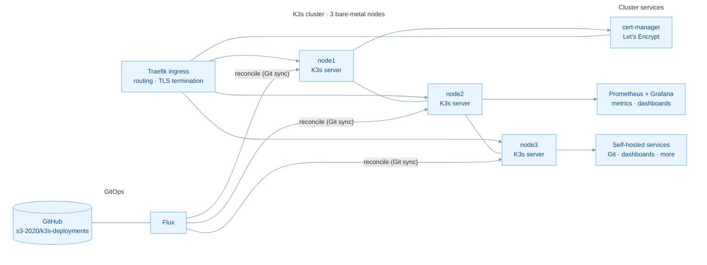

# Homelab — multi-node K3s cluster, driven by GitOps

Hi, I'm **Jess Steen Hansen** — data technician (IT infrastructure) student at
team.blue, finishing January 2027. Cisco CCNA certified, currently studying
for CCNP.

This repository documents my home lab: a small but production-minded
environment I run to stay sharp and to test things before they touch real
workloads. It is intentionally small and sharp — same principles as
professional operations, smaller scale.

## The stack

Three separate bare-metal servers run the K3s cluster — real nodes, not VMs on
a single hypervisor. Networking between nodes, VLANs and firewalling are
handled at the network layer (Cisco, CCNA level).

Storage: btrfs / ext4 / ZFS, with tested backup routines — snapshots are not
backups, so both exist.

## What runs where

| Layer | Technology | Purpose |
|---|---|---|
| Compute | 3 bare-metal servers | K3s cluster nodes |
| Cluster | K3s | Kubernetes the light way |
| Config management | Flux CD | Everything as code, synced from Git |
| Ingress | Traefik | Routing, TLS termination |
| Certificates | cert-manager | Automated Let's Encrypt |
| Monitoring | Prometheus + Grafana | Metrics, dashboards, alerts |
| Network | Cisco (CCNA) | VLANs, routing, firewalling |
| Storage | btrfs / ZFS | Node storage, tested backups |

## The repositories

| Repo | What it shows |
|---|---|
| [`k3s-deployments`](https://github.com/s3-2020/k3s-deployments) | GitOps application layer — Flux-synced workloads (Rancher, Grafana, Hubble, dashboards) |
| [`kube-labs`](https://github.com/s3-2020/kube-labs) | A structured network lab: DNS → Services → NetworkPolicy → Gateway → Cilium → chaos, with exercises and solutions |
| `k3s-gitops` *(private)* | Cluster bootstrap and infrastructure: Traefik, cert-manager, PKI, TrueNAS CSI, monitoring stack |

## Why I run it

Because the best way to learn operations is to operate. When something
breaks at 10 PM, there is no on-call — but there is a very instructive
troubleshooting session. What I learn here shows up at work the next day.

---

*Contact: [LinkedIn — Jess Steen Hansen](https://www.linkedin.com/in/jesssteenhansen)*
